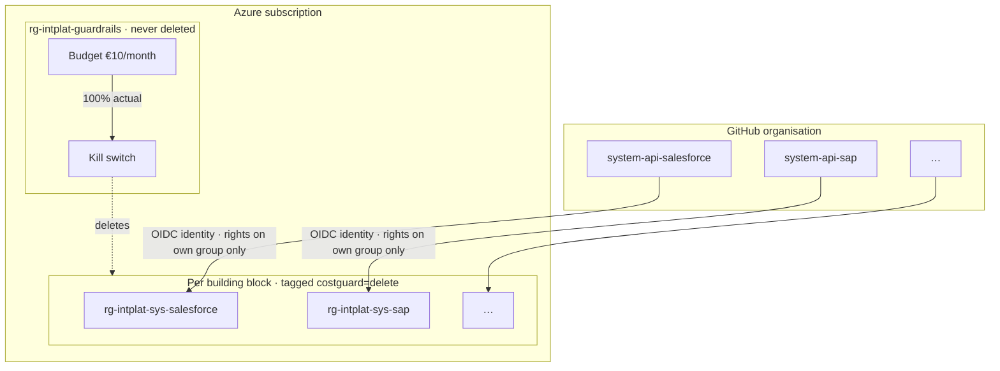

# azure-landing-zone

Subscription-level foundation for the
[AI Intelligence Domain demo](https://github.com/azure-intelligence-domain/ai-intelligence-domain).
Owned by the **platform team**. Deployed before anything else.

| Folder | What | Status |
|---|---|---|
| [`bootstrap/`](bootstrap/) | The landing zone's own deploy identity (GitHub OIDC), and the Entra application of the agent gateway ([`agent-gateway-app.sh`](bootstrap/agent-gateway-app.sh)). Run once by hand. | ✅ deployed |
| [`guardrails/`](guardrails/) | €10/month budget, alerts and the kill switch. Deployed by the [`guardrails`](.github/workflows/guardrails.yml) pipeline. | ✅ deployed |
| [`building-blocks/`](building-blocks/) | Per building block: resource group (tagged `costguard=delete`) and a deploy identity with Contributor on that group only. One entry in [`main.bicepparam`](building-blocks/main.bicepparam) per block. Deployed by the [`building-blocks`](.github/workflows/building-blocks.yml) pipeline. | ✅ eventcatalog |
| [`modules/`](modules/) | Shared Bicep modules. [`roles.bicep`](modules/roles.bicep) lists every role the platform hands out: building blocks get Contributor plus a role administrator limited to eight data-plane roles, on their own resource groups only. | — |

Decisions: [ADR 0003](https://github.com/azure-intelligence-domain/ai-intelligence-domain/blob/main/docs/adr/0003-azure-consumption-with-cost-cap.md)
(cost cap) and [ADR 0004](https://github.com/azure-intelligence-domain/ai-intelligence-domain/blob/main/docs/adr/0004-api-led-composable.md)
(composable building blocks).
