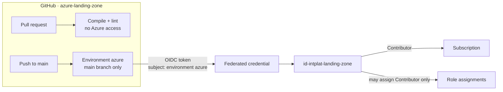

# Bootstrap — the landing zone's deploy identity

The one thing that is deployed **by hand**, once, by a subscription Owner.
After this, everything in this repository is deployed by GitHub Actions.

| Resource | Name | Purpose |
|---|---|---|
| Resource group | `rg-intplat-identities` | Holds all deploy identities. **Not** tagged `costguard=delete`, so the pipelines can rebuild after a kill switch run. |
| Managed identity | `id-intplat-landing-zone` | What the `azure-landing-zone` pipeline logs in as. |
| Federated credential | `github` | Trusts only `repo:azure-intelligence-domain@343586903/azure-landing-zone@1422302934:environment:azure`. GitHub includes the numeric IDs, so a recreated repository with the same name gets no access. |
| Role | Contributor on the subscription | Creates guardrails and building-block resource groups. |
| Role | RBAC Administrator, **constrained** | May grant or remove the **Contributor role only**. It can never make anything Owner, including itself. |



## Why the environment matters

The federated credential trusts the GitHub **environment** `azure`, and that
environment only accepts deployments from `main`. A pull request, a branch or
a fork cannot get an Azure token.

## Deploy (once)

```bash
az deployment sub create --name bootstrap --location belgiumcentral \
  --template-file bootstrap/main.bicep
```

Then store the outputs as secrets of the GitHub environment `azure`:
`AZURE_CLIENT_ID` (output `clientId`), `AZURE_TENANT_ID`,
`AZURE_SUBSCRIPTION_ID`, plus `ALERT_EMAIL` for the guardrails.
