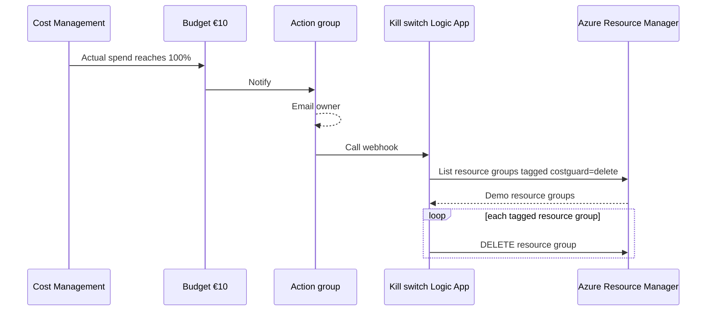

# Guardrails — cost cap and kill switch

Implements [ADR 0003](https://github.com/azure-intelligence-domain/ai-intelligence-domain/blob/main/docs/adr/0003-azure-consumption-with-cost-cap.md).
Deployed **once per subscription, before anything else**.

| Resource | Name | Purpose |
|---|---|---|
| Resource group | `rg-intplat-guardrails` | Holds the kill switch. Not tagged for deletion. |
| Budget | `budget-intplat-monthly` | €10/month. Email at 50% and 80% actual, 100% forecast. Kill switch at 100% actual. |
| Action group | `ag-intplat-killswitch` | Emails the owner and calls the kill switch. |
| Logic App (Consumption) | `logic-intplat-killswitch` | Deletes every resource group tagged `costguard=delete`. |
| Role assignment | Contributor on the subscription | Lets the kill switch delete those resource groups. |



## The tagging rule

Every resource group of the demo gets the tag **`costguard=delete`**. Only the
guardrails resource group does not. A resource group without the tag survives
the kill switch, so forgetting the tag is a cost risk.

## Deploy

```bash
az deployment sub create \
  --name guardrails \
  --location belgiumcentral \
  --template-file guardrails/main.bicep \
  --parameters alertEmail=<your email>
```

The alert email is passed at deploy time and never committed (public repo).

## Test the kill switch

Create a throwaway resource group with the tag, trigger the Logic App
manually, and check that the group is gone:

```bash
az group create -n rg-intplat-killswitch-test -l belgiumcentral --tags costguard=delete
az rest --method post --url "$(az rest --method post \
  --url "https://management.azure.com/subscriptions/<sub-id>/resourceGroups/rg-intplat-guardrails/providers/Microsoft.Logic/workflows/logic-intplat-killswitch/triggers/budget_alert/listCallbackUrl?api-version=2019-05-01" \
  --query value -o tsv)" --body '{}' --skip-authorization-header
az group exists -n rg-intplat-killswitch-test   # false after a minute
```

## Limits

- Azure cost data lags several hours, so deletion can happen slightly after
  €10 is reached. With consumption tiers the overshoot is cents.
- Budgets reset monthly. After a kill, redeploy the demo from Bicep.
